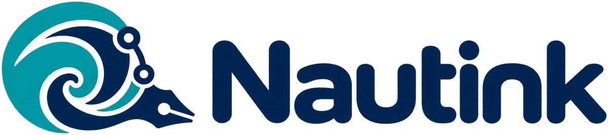
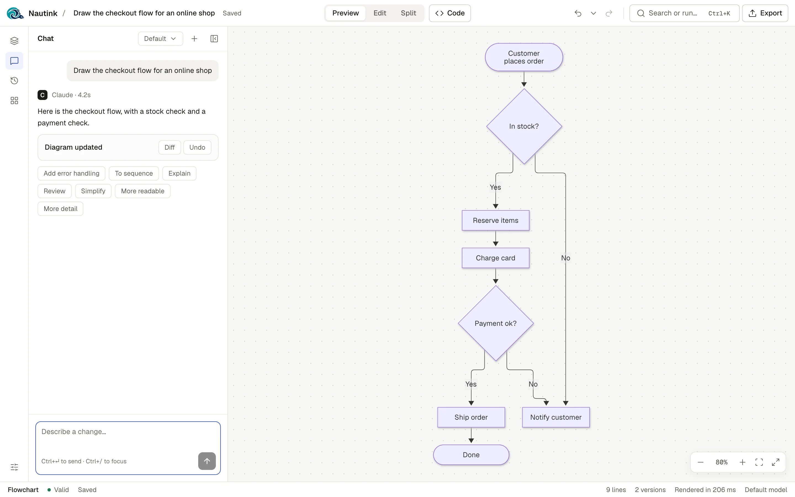
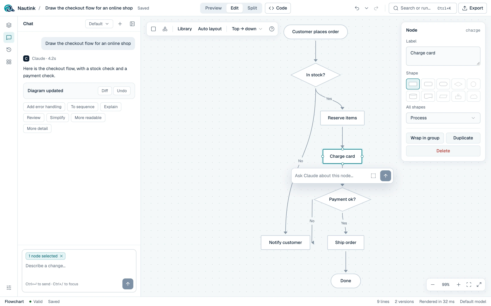
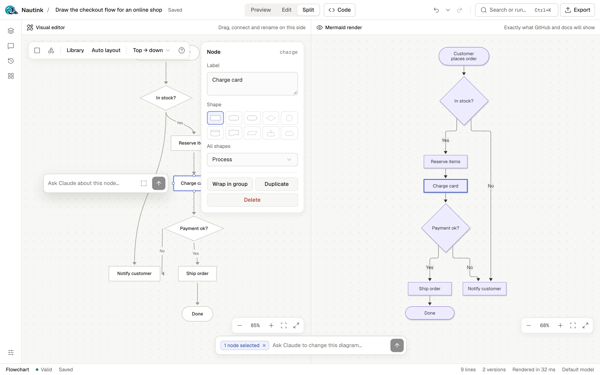
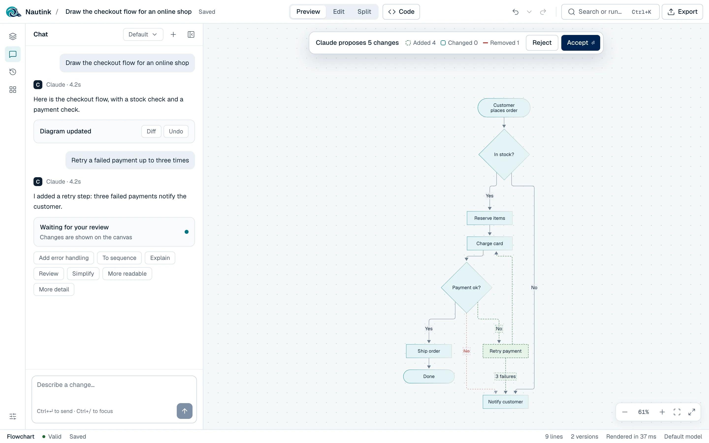
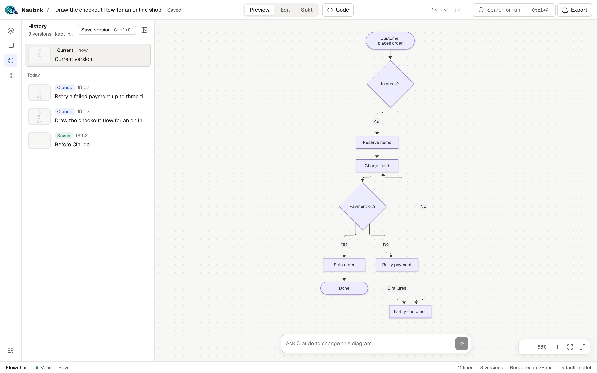
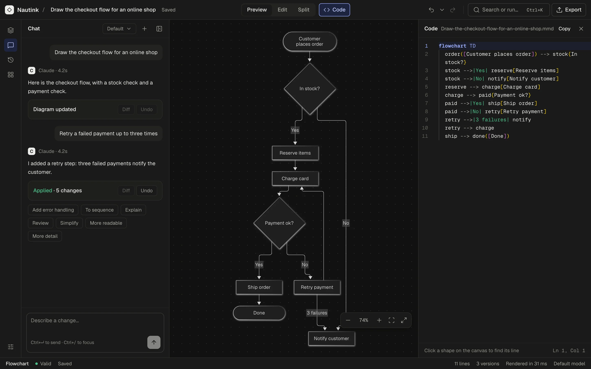

<h1 align="center">
  <picture>
    <source media="(prefers-color-scheme: dark)" srcset="docs/brand/nautink-logo-dark.webp" />
    
  </picture>
</h1>

A local-first, open-source app for building [Mermaid](https://mermaid.js.org) diagrams. You shape one
canvas by hand, in code, or by chatting with a coding agent, and every change the agent proposes is
shown on the canvas for you to accept or reject. Your diagrams stay in your browser; the chat runs
through your own [Claude Code](https://docs.anthropic.com/en/docs/claude-code) or
[Codex](https://github.com/openai/codex) CLI on your machine.



## Features

- **Chat with Claude or Codex.** Pick the agent in Settings. Describe a diagram or a change; the reply
  goes straight into the canvas. Pick the model (the default, or the agent's own models: Opus, Sonnet
  or Haiku for Claude, the installed Codex CLI's models for Codex), stop a reply, start a new chat, or
  use the quick actions under each reply. If Claude's code does not parse, Nautink asks it to fix it (up to two
  retries), and a parse error in your own code has an "Ask Claude to fix" button.
- **Review before apply.** Claude's change appears on the canvas as a proposal: added parts dashed in
  green, changed parts outlined, removed parts struck through. Accept with Enter, reject with Esc.
  Accepting is one undo step and one saved version. Code-only diagram types show the proposal as a
  code diff. You can turn review off in Settings.
- **Live build.** While a reply streams, new nodes fade in on a read-only canvas.
- **Five visual editors.** Flowchart (53 shapes, groups, icon nodes, auto layout), UML class, sequence,
  ER and state diagrams, each with a floating inspector. Every visual edit writes plain Mermaid code.
- **Preview, Edit and Split.** Preview shows Mermaid's own render with pan, zoom, fit and focus mode;
  click a shape to jump to its line of code. Edit is the visual editor. Split puts the editor beside
  the real render, with the selection mirrored between them.
- **Selection-aware prompts.** Select nodes and ask Claude about just those ("Ask Claude about these
  2 nodes…"); the prompt tells Claude to leave everything else alone.
- **Code drawer.** Monaco with Mermaid highlighting, autocomplete per diagram type, and the parse
  error marked on its line.
- **History and versions.** Undo and redo cover every change (200 labelled steps). Each Claude edit
  saves a version; save your own with ⌘S. View, compare and restore up to 50 versions per diagram, and
  undo a restore.
- **Many diagrams.** Search titles and content, filter by type, pin, rename, duplicate, download and
  delete (with undo). Titles are picked from the code until you rename.
- **Templates.** A gallery of 14 diagram types across process, software design, data, planning and
  charts, each with an example, plus a blank for each of the five visual editor types.
- **Export.** Download SVG or PNG (scale, transparent background), copy the image, the SVG, the code,
  Markdown or an HTML embed, or open the diagram in mermaid.live.
- **Import and backups.** Drop or pick `.mmd`, `.mermaid` or Markdown files (one diagram per Mermaid
  block). Back up everything to one JSON file and restore it, including backups from v1 (Mermaid Chat).
- **Command palette.** ⌘K reaches every action.
- **Themes.** System, light or dark.
- **Codebase-aware chat (optional).** Let Claude read a project folder (read-only) so it can draw your
  real architecture.

<table>
  <tr>
    <td></td>
    <td></td>
  </tr>
  <tr>
    <td align="center">Edit mode with the inspector</td>
    <td align="center">Split</td>
  </tr>
  <tr>
    <td></td>
    <td></td>
  </tr>
  <tr>
    <td align="center">Reviewing Claude's change</td>
    <td align="center">Version history</td>
  </tr>
  <tr>
    <td colspan="2"></td>
  </tr>
  <tr>
    <td colspan="2" align="center">Dark theme with the code drawer</td>
  </tr>
</table>

## Requirements

- **Node 22** (22.18 or newer).
- **[Claude Code](https://docs.anthropic.com/en/docs/claude-code)** or
  **[Codex CLI](https://github.com/openai/codex)**, installed and logged in, for the chat. Nautink
  runs the `claude` or `codex` command on your `PATH` (set `CLAUDE_BIN` or `CODEX_BIN` to use
  another). Without one, everything except the chat still works, and Settings shows the connection
  status.
- A current Chrome, Edge, Safari or Firefox.

## Quick start

```bash
npx nautink
```

This starts Nautink on http://127.0.0.1:8791 (localhost only) and opens it in your browser. Stop it
with Ctrl+C. `npx nautink --help` lists the options (`--port`, `--no-open`); the settings
(`API_PORT`, `CLAUDE_BIN`, `CODEX_BIN`, `REPO_DIR`) are in [`apps/cli/README.md`](apps/cli/README.md).

`npx nautink` works once the first release is on npm. Until then, or to work on Nautink itself, run
it from source with pnpm 9:

```bash
git clone https://github.com/NatanGer97/nautink.git
cd nautink
pnpm install
pnpm dev
```

Then open http://localhost:5190. [CONTRIBUTING.md](CONTRIBUTING.md#running-the-app) has the details.

## How it works

```
 Browser                                   Your machine
┌───────────────────────────────┐        ┌──────────────────────────────┐        ┌──────────────────┐
│ Nautink web app (React)       │  /api  │ Local server (Node, Express) │ spawns │ Claude Code CLI  │
│ canvas · editors · chat       │ ─────► │ 127.0.0.1:8791 only          │ ─────► │ claude -p        │──► Anthropic,
│ IndexedDB: diagrams, versions │ ◄───── │ Host guard, Zod validation   │ ◄───── │ your own login   │    as Claude Code
└───────────────────────────────┘  SSE   └──────────────────────────────┘ stream └──────────────────┘    does today
```

- **The web app** keeps every diagram, chat, version and canvas position in your browser's IndexedDB.
  There is no account and no cloud storage.
- **The local server** turns each chat message into one `claude -p` run with the diagram and your
  prompt, and streams the reply back as Server-Sent Events. It keeps Claude lean: no MCP servers, no
  slash commands, no user settings, and no tools at all unless you choose a codebase folder, which
  allows read-only `Read`, `Grep` and `Glob`. With Codex it runs `codex exec` instead, always in a
  read-only sandbox and without your Codex config (see
  [ADR-002](docs/adr/002-codex-agent.md)).
- **Mermaid** renders the preview and parses the code for the visual editors, so what you see is what
  GitHub and other Mermaid hosts will show.

The monorepo has two apps (`apps/web`, `apps/server`) and five libraries (`packages/*`); see
[CONTRIBUTING.md](CONTRIBUTING.md#repo-layout) for the layout and [docs/PRD.md](docs/PRD.md) for the
full product spec.

## Privacy

Nautink has no telemetry, no analytics and no account. Your diagrams never leave your browser except
when you send a chat message: then the local server passes the diagram, your message and any
selection to your Claude Code CLI, which sends them to Anthropic under your Claude account, exactly as
if you used Claude Code yourself. If you choose a codebase folder, Claude can read files in it during
a chat. Fonts and icons are bundled; the app loads nothing from third-party servers at runtime.
"Open in mermaid.live" sends the diagram to mermaid.live only when you click it, and the copied HTML
embed loads Mermaid from the jsDelivr CDN wherever you paste it.

See [SECURITY.md](SECURITY.md) for the threat model and how to report a vulnerability.

## Keyboard shortcuts

⌘ is Ctrl on Windows and Linux.

| Shortcut | Action |
| --- | --- |
| ⌘K | Command palette |
| ⌘/ | Focus the chat |
| ↵ or ⌘↵ | Send the message (⇧↵ adds a new line) |
| ⌘Z | Undo |
| ⇧⌘Z or ⌘Y | Redo |
| ⌘S | Save a version |
| ⇧⌘E | Download SVG |
| ⇧⌘C | Copy the image |
| ↵ / Esc | Accept / reject Claude's proposal (when no field has focus) |
| Esc | Leave focus mode, close a dialog or menu |

On the visual editor's canvas:

| Shortcut | Action |
| --- | --- |
| ↵ | Rename the selected item |
| Esc | Clear the selection |
| Delete or Backspace | Delete the selection |
| ⌘D | Duplicate (flowchart and class) |
| Arrow keys | Move the selection 1 px (⇧ for 10 px); in a sequence diagram, ↑ ↓ move rows |
| ⇧1 | Fit the diagram to the view |
| ⇧ or ⌘ + click | Add to the selection |

## Project status

Nautink is a TypeScript rebuild of Mermaid Chat (v1) and is in its last pre-release phase: every v1
feature and the new AI-native features are in, and accessibility, performance budgets and release
docs are being finished. There is no tagged release yet, and nothing is published to a package
registry. Expect breaking changes until 1.0.

## Coming soon

Nautink is growing into a place to design a feature with your AI before it writes the code. Each item
links to its issue; follow it there or say what you need.

**First release**

- [`npx nautink` on npm](https://github.com/NatanGer97/nautink/issues/4): a `0.1.0` preview, so you can
  start Nautink with one command and no clone.
- [A hosted demo](https://github.com/NatanGer97/nautink/issues/3): try the editors, templates and export
  in the browser before you install anything.

**From diagram to design**

- [Diagrams as files in your repo](https://github.com/NatanGer97/nautink/issues/6): pick a folder such as
  `docs/design/`, and Nautink reads and writes its Markdown and `.mmd` files, so designs are reviewed in
  pull requests ([ADR-004](docs/adr/004-project-folder-storage.md)).
- [Designs](https://github.com/NatanGer97/nautink/issues/7): several diagrams plus the problem, options,
  decision and open questions, in one place the AI sees as a whole.
- [Export a design as a plan](https://github.com/NatanGer97/nautink/issues/8) that Claude Code or Codex
  can build from.
- [Review an agent's diagram in Nautink](https://github.com/NatanGer97/nautink/issues/9): a local MCP
  server lets your coding agent open its proposed diagram on the canvas for you to edit, accept or
  reject.

## Contributing

Contributions are welcome. Start with [CONTRIBUTING.md](CONTRIBUTING.md) (setup, the gates, and how
changes are made) and the [Code of Conduct](CODE_OF_CONDUCT.md). Coding agents read
[AGENTS.md](AGENTS.md).

## License

[MIT](LICENSE). The MIT license covers the code only: the Nautink name and logo (the files in
[`docs/brand/`](docs/brand/) and the app icons made from them) are not licensed under it. Forks are
welcome, but please give them their own name and logo.

Third-party packages, icon sets and fonts keep their own licenses; see
[THIRD_PARTY_NOTICES.md](THIRD_PARTY_NOTICES.md). Nautink is not affiliated with the Mermaid project
or with Anthropic.
